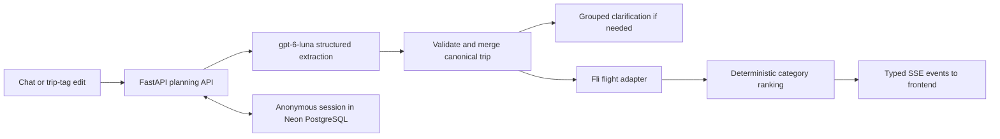

# Flight planning

The first live planning flow searches round-trip flights for 1–9 adults, in English and USD.
Accounts, children/infants, hotels, payments and booking are later features. The existing
flights-and-hotels sample preview remains available at `/preview/results`.

## Flow and ownership



There is one chat model. LangChain configures its OpenAI Responses API connection and strict
Pydantic structured output. LangGraph runs extraction → validation → search/response. Direct
tag edits skip the model. Fli is called as a Python library; this flow has no MCP server or
browser automation. The application controls readiness, queries, prices and ranking.

The model receives the current trip, supported preferences, recent messages, a bounded set of
known offers, and the browser's local date/time zone. It proposes explicit field changes and
clarifications. Missing values are not guessed; null clears a field, omission preserves it.
Airport codes are checked against airport data, and ambiguous cities prompt an airport choice.
Dates must be real, not in the past, and return must follow departure. Bare dates without a
year and unclear passenger/budget details prompt clarification. Children are never converted
to adults. Unsupported preferences prompt clarification rather than being silently accepted.

## Canonical trip

```json
{
  "origin": "SDQ",
  "destination": "JFK",
  "departureDate": "2027-02-10",
  "returnDate": "2027-02-15",
  "travelers": 2,
  "budgetUsd": null,
  "flightBudgetUsd": 800
}
```

`travelers` means adults. The two budgets are separate: `budgetUsd` retains its original
combined flights-and-hotel meaning; `flightBudgetUsd` is the optional soft target for the
whole party's round-trip flights. The live UI labels it **Flight budget**. No budget is
required to search. Supported refinements are maximum stops (0–2), earliest departure hour
(airport-local, both directions), and an explicit cabin or flexible cabin choice.

The backend searches immediately after validation succeeds. It persists the accepted trip
and emits `search.started` before making a flight request. It searches economy first, then
considers premium economy and business. Initial exploration thresholds compare the target
plus 15% headroom against 1.4× / 2.5× the cheapest observed quote. These are configurable-in-code
exploration heuristics, not predicted cabin prices. Explicit cabin requests override this
gate. First class is excluded. With no budget, all three supported cabins may be explored.

## Offers and categories

The pinned Fli revision is `881aee5ff4321e81ea2157cb44be94ce6a21dc1b`; `certifi` is separately
constrained above the vulnerable dependency floor noted in the Fli review. The adapter validates
both directions and their dates, retains actual per-leg cabins, and identifies mixed/unknown
cabins without claiming every leg matches the search cabin. It requests USD and only accepts
positive finite USD totals. Missing/unusable prices are silently omitted from priced results.

The upstream round-trip contract uses **outbound.price as the complete party total**. The
application neither adds the inbound price nor multiplies by adults. Booking links preserve
passengers and the searched cabin. Quotes have retrieval timestamps; prices and fare/baggage
conditions must be checked with the seller before booking.

The ranking policy lives in `apps/api/src/travel_aid/recommendations/flights.py`:

| Category | Initial policy |
| --- | --- |
| Budget | Lowest-priced suitable complete trip among the returned offers. |
| Mid-range | Balance duration, stops, cabin and cost; both initial departures must be at or after 5 AM. |
| Luxury | Give comfort more weight while penalizing long journeys and excessive cost. |

Categories are independent of cabins: a convenient economy itinerary can beat a premium
itinerary with a long connection. The policy picks up to three distinct offers, depending on
availability and constraints. Dollar and percentage overages accompany every over-budget
recommendation. Additional returned flights are available for comparison. Choosing one saves
a preference; it does not book a ticket.

Identical routes/preferences reuse quotes for 15 minutes. A flight-budget edit reranks cached
offers and explores only newly eligible cabins. A refresh explicitly reruns the search.
Asking for more options expands Fli's outbound candidate depth from 3 by steps of 2, capped
at 10; Fli may return multiple inbound choices per outbound. More-options requests retain
completed candidates and the selected preference. Route/passenger/preference changes clear
incompatible results. Ranking weights and exploration thresholds can be tuned independently
of the model and transport.

## API and browser transport

All routes use an opaque HttpOnly same-site cookie, scoped to `/api/planning`.

| Method and path | Purpose |
| --- | --- |
| `POST /api/planning/session` | Create or recover the current same-browser session; returns its snapshot. |
| `POST /api/planning/messages` | Accept chat text, a direct trip patch, or an explicit retry; streams SSE. |
| `POST /api/planning/selection` | Persist a current offer ID using the expected session revision. |

Messages carry `requestId` (UUID), `expectedRevision`, `text`, `patch`, `timezone` (IANA), and
`retry`. Unknown fields and malformed values fail validation. The backend claims a bounded
session lease before external work. Revision checks and duplicate request protection reject
stale/concurrent requests with HTTP 409. The frontend recovers the current revision before
asking the user to retry; it does not automatically repeat model/provider work.

The browser uses **Fetch POST + a streamed response**, not polling or a WebSocket. Each frame
contains one typed `PlanningEvent` with `type`, `session`, and optional `message`:

1. `session.updated`: the accepted turn is recorded.
2. `trip.updated`: validated canonical details are available.
3. `search.started`: the plan is ready and flight searching has started.
4. `flights.ready`: a completed cabin query has been normalized and saved.
5. `assistant.message`: a clarification or result explanation is ready.
6. `turn.completed` or `turn.failed`, followed by completion/cleanup.

Snapshot events keep tags, transcript, cards and selection consistent. Stale revisions are
ignored. Manual edits made during an active turn remain visible and are queued for the next
turn; old results are hidden until those edits are accepted. Network chunk boundaries and
multibyte characters are handled by the SSE decoder. The generated TypeScript client and
types come from FastAPI OpenAPI; run `pnpm generate:api-client` after contract changes.

## Persistence and cancellation

Neon through Vercel supplies ordinary PostgreSQL connections. Runtime uses pooled
`DATABASE_URL`; migrations prefer direct `DATABASE_URL_UNPOOLED`. The initial idempotent SQL
migration ships inside the Python package. Run `cd apps/api && uv run migrate` before enabling
planning. Configure database credentials before running the migration.

Only a hash of the browser's random token is stored. The database owns trip/preferences,
messages (bounded history), offers, recommendations, selected offer, revision and run lease.
Sessions expire after 30 days of inactivity by default, renewed on access/activity. Expired
records are removed in bounded batches when new sessions are created. This is expiry-based
recovery with opportunistic cleanup, not a guarantee of deletion at the exact expiry instant.
Cookie deletion, expiry or a different browser starts a new anonymous session. Account-based
saving is not part of this release.

Accepted details and each completed cabin's offers are saved before emitting their events.
Closing the page, leaving it, or pressing Stop aborts the browser request. Server disconnect
detection cancels the model/workflow and signals the adapter to stop further HTTP work. Active
blocking HTTP requests may continue until their timeout (at most 10 seconds per request);
Fli's internal parser waits may also finish before noticing cancellation. Cabin work shares
a 75-second deadline. There is no durable background search. On failure, current accepted
work survives; an abandoned 180-second lease is recovered as interrupted on the next access.
Application snapshots are not LangGraph checkpoints and do not resume inside a model call.

## Configuration and verification

Copy `apps/api/.env.example` to `.env`, configure the model/Neon credentials, migrate, then
start the two development servers from the root README. Keep keys server-side. `WEB_ORIGIN`
must match a frontend origin that uses a proxy with a different API Host header; its local
default is `http://localhost:3000`. Use HTTPS and `ENVIRONMENT=production` / `preview` for
secure deployment cookies. Settings also bound cache age, search duration and retention.

Local tests cover validation, airport ambiguity, category rules, overages, price normalization,
workflow event order, cancellation signals, cookie recovery, stale requests, and stream
decoding. A dedicated `TEST_DATABASE_URL` enables PostgreSQL concurrency/expiry tests; CI
supplies a PostgreSQL service. Test doubles are isolated to tests and a temporary browser QA
harness, with no runtime fallback. A live Fli adapter smoke check returned priced two-adult
SDQ–JFK pairs. Browser QA checked chat → tags → cards, saved-selection recovery, and budget
edits against fixture data. Connectivity, migration, and HTTP session creation/recovery were
also verified against a configured Neon database. A live OpenAI call remains unverified.
